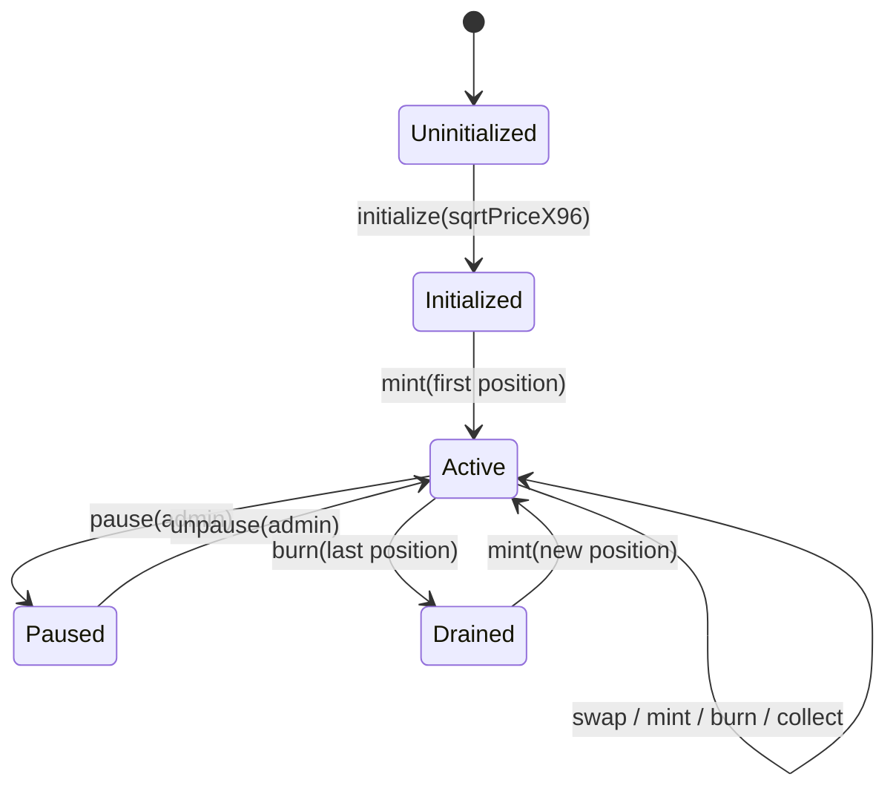
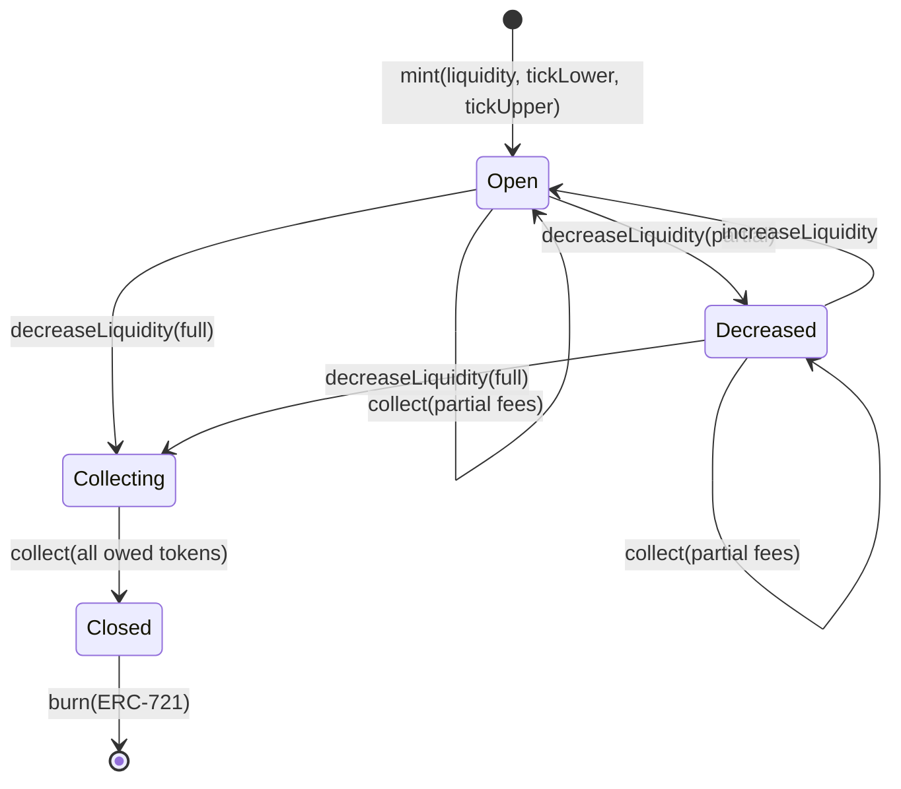
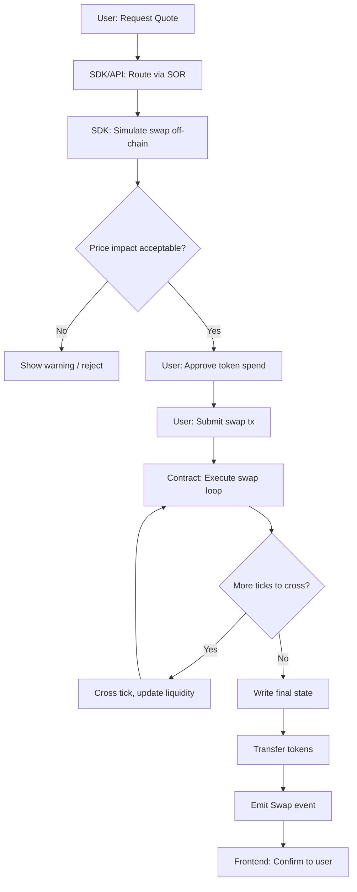

# OmniFi — EVM Concentrated-Liquidity AMM (CLMM) Math Specification

**Version:** 1.0  
**Status:** Phase 1 deliverable  
**Date:** 2026-11-01  
**Related ADRs:** ADR-003 (Accepted), ADR-007 (Accepted), ADR-008 (Accepted), ADR-009 (Accepted)  
**Prerequisite for:** EVM CLMM contracts, SDK, SOR, frontend liquidity UI  
**Dependencies:** `fee-and-rounding-spec.md`

---

## Table of Contents

1. [Fixed-Point Formats and Constants](#1-fixed-point-formats-and-constants)
2. [Tick ↔ Price Conversion](#2-tick--price-conversion)
3. [Sqrt-Price Representation](#3-sqrt-price-representation)
4. [Liquidity and Amount Calculations](#4-liquidity-and-amount-calculations)
5. [Swap Step Formulas](#5-swap-step-formulas)
6. [Tick Crossing and Liquidity-Net Updates](#6-tick-crossing-and-liquidity-net-updates)
7. [Fee Growth Accounting](#7-fee-growth-accounting)
8. [Position Valuation and Fee Collection](#8-position-valuation-and-fee-collection)
9. [Tick Bitmap and Indexing](#9-tick-bitmap-and-indexing)
10. [Overflow Bounds Analysis](#10-overflow-bounds-analysis)
11. [Dust Handling and Boundary Behavior](#11-dust-handling-and-boundary-behavior)

> [!NOTE]
> **Oracle (§12) is DEFERRED** per ADR-009. No observation array, no cumulative price tracking, no TWAP support in Release 1. If added later, it will be a separate addendum.

---

## 1. Fixed-Point Formats and Constants

### 1.1 Q64.96 Format

The primary fixed-point format for sqrt-price representation:

```
Q64.96:  uint160 value where:
  - Upper 64 bits: integer part
  - Lower 96 bits: fractional part
  - Real value = value / 2^96
```

Precision: approximately 24 decimal digits of fractional precision.

### 1.2 Q128.128 Format

Used for fee growth accumulators to maintain precision across many small fee increments:

```
Q128.128:  uint256 value where:
  - Upper 128 bits: integer part
  - Lower 128 bits: fractional part
  - Real value = value / 2^128
```

### 1.3 Core Constants

| Constant | Value | Type | Description |
|----------|-------|------|-------------|
| `MIN_TICK` | -887272 | int24 | Minimum usable tick |
| `MAX_TICK` | 887272 | int24 | Maximum usable tick (= -MIN_TICK) |
| `MIN_SQRT_PRICE` | 4295128739 | uint160 | sqrtPrice at MIN_TICK (≈ 2^-64 in Q64.96) |
| `MAX_SQRT_PRICE` | 1461446703485210103287273052203988822378723970342 | uint160 | sqrtPrice at MAX_TICK (≈ 2^64 in Q64.96) |
| `FEE_DENOMINATOR` | 1_000_000 | uint24 | Fee representation denominator |
| `Q96` | 2^96 = 79228162514264337593543950336 | uint256 | Scaling factor |
| `Q128` | 2^128 = 340282366920938463463374607431768211456 | uint256 | Fee growth scaling |
| `MAX_LIQUIDITY` | type(uint128).max = 2^128 - 1 | uint128 | Maximum liquidity per position/tick |

### 1.4 Fee Tier Constants

From `fee-and-rounding-spec.md`:

| Constant | Fee (integer) | Tick Spacing |
|----------|-------------|--------------|
| `FEE_TIER_100` | 100 | 1 |
| `FEE_TIER_500` | 500 | 10 |
| `FEE_TIER_3000` | 3000 | 60 |
| `FEE_TIER_10000` | 10000 | 200 |

### 1.5 Precision Bounds

| Quantity | Representation | Max Value | Bits Required |
|----------|---------------|-----------|---------------|
| sqrtPriceX96 | Q64.96 uint160 | MAX_SQRT_PRICE | 160 |
| liquidity | uint128 | 2^128 - 1 | 128 |
| tick | int24 | ±887272 | 24 (signed) |
| feeGrowthX128 | Q128.128 uint256 | 2^256 - 1 | 256 (wrapping) |
| token amounts | uint256 | 2^256 - 1 | 256 |

---

## 2. Tick ↔ Price Conversion

### 2.1 Mathematical Relationship

Each tick `i` maps to a price:

$$p(i) = 1.0001^i$$

The sqrt-price at tick `i`:

$$\sqrt{p(i)} = 1.0001^{i/2}$$

This means each tick represents a 0.01% (1 basis point) price change.

### 2.2 Tick Range

- Valid ticks: `MIN_TICK` ≤ `tick` ≤ `MAX_TICK`
- `MIN_TICK = -887272` → price ≈ 2^(-128) ≈ 2.94 × 10^(-39)
- `MAX_TICK = 887272` → price ≈ 2^(128) ≈ 3.40 × 10^(38)
- This covers effectively all practical price ratios between any two ERC-20 tokens

### 2.3 Tick Spacing Rules

Only ticks divisible by `tickSpacing` can serve as position boundaries:

```
RULE: tick % tickSpacing == 0 → tick is initializable
```

| Fee Tier | Tick Spacing | Price Granularity per Initializable Tick |
|----------|--------------|----------------------------------------|
| 0.01% | 1 | 0.01% |
| 0.05% | 10 | ≈ 0.10% |
| 0.30% | 60 | ≈ 0.60% |
| 1.00% | 200 | ≈ 2.02% |

### 2.4 Tick → Sqrt-Price Conversion

Given tick `i`, compute `sqrtPriceX96`:

```
function getSqrtPriceAtTick(tick: int24) → uint160:
    REQUIRE: MIN_TICK <= tick <= MAX_TICK

    absTick = abs(tick)

    // Start with base ratio
    // Use precomputed magic numbers for each bit of absTick
    // to compute 1.0001^(absTick/2) via binary decomposition
    
    ratio = 0x100000000000000000000000000000000  // Q128.128 = 1.0

    if absTick & 0x1:     ratio = ratio * 0xfffcb933bd6fad37aa2d162d1a594001 / Q128
    if absTick & 0x2:     ratio = ratio * 0xfff97272373d413259a46990580e213a / Q128
    if absTick & 0x4:     ratio = ratio * 0xfff2e50f5f656932ef12357cf3c7fdcc / Q128
    if absTick & 0x8:     ratio = ratio * 0xffe5caca7e10e4e61c3624eaa0941cd0 / Q128
    if absTick & 0x10:    ratio = ratio * 0xffcb9843d60f6159c9db58835c926644 / Q128
    if absTick & 0x20:    ratio = ratio * 0xff973b41fa98c081472e6896dfb254c0 / Q128
    if absTick & 0x40:    ratio = ratio * 0xff2ea16466c96a3843ec78b326b52861 / Q128
    if absTick & 0x80:    ratio = ratio * 0xfe5dee046a99a2a811c461f1969c3053 / Q128
    if absTick & 0x100:   ratio = ratio * 0xfcbe86c7900a88aedcffc83b479aa3a4 / Q128
    if absTick & 0x200:   ratio = ratio * 0xf987a7253ac413176f2b074cf7815e54 / Q128
    if absTick & 0x400:   ratio = ratio * 0xf3392b0822b70005940c7a398e4b70f3 / Q128
    if absTick & 0x800:   ratio = ratio * 0xe7159475a2c29b7443b29c7fa6e889d9 / Q128
    if absTick & 0x1000:  ratio = ratio * 0xd097f3bdfd2022b8845ad8f792aa5825 / Q128
    if absTick & 0x2000:  ratio = ratio * 0xa9f746462d870fdf8a65dc1f90e061e5 / Q128
    if absTick & 0x4000:  ratio = ratio * 0x70d869a156d2a1b890bb3df62baf32f7 / Q128
    if absTick & 0x8000:  ratio = ratio * 0x31be135f97d08fd981231505542fcfa6 / Q128
    if absTick & 0x10000: ratio = ratio * 0x9aa508b5b7a84e1c677de54f3e99bc9  / Q128
    if absTick & 0x20000: ratio = ratio * 0x5d6af8dedb81196699c329225ee604   / Q128
    if absTick & 0x40000: ratio = ratio * 0x2216e584f5fa1ea926041bedfe98      / Q128
    if absTick & 0x80000: ratio = ratio * 0x48a170391f7dc42444e8fa2           / Q128

    // If tick > 0, invert: 1.0001^(tick/2) = 1 / (1.0001^(-tick/2))
    if tick > 0:
        ratio = type(uint256).max / ratio

    // Convert Q128.128 → Q64.96 (right-shift by 32)
    sqrtPriceX96 = uint160(ratio >> 32)
    // Add 1 if there was a remainder (round up for positive ticks)
    if ratio % (1 << 32) != 0:
        sqrtPriceX96 += 1

    return sqrtPriceX96
```

**Rounding:** The result is the smallest Q64.96 value ≥ the true sqrt-price.

### 2.5 Sqrt-Price → Tick Conversion

Given `sqrtPriceX96`, find the largest tick `i` such that `getSqrtPriceAtTick(i) <= sqrtPriceX96`:

```
function getTickAtSqrtPrice(sqrtPriceX96: uint160) → int24:
    REQUIRE: MIN_SQRT_PRICE <= sqrtPriceX96 < MAX_SQRT_PRICE

    // Compute log base 1.0001 of (sqrtPriceX96 / Q96)^2
    // Using binary search or bit-manipulation on the 
    // most-significant-bit of sqrtPriceX96

    // Step 1: Compute msb of sqrtPriceX96
    // Step 2: Use iterative refinement to compute log_2
    // Step 3: Convert log_2 to log_{sqrt(1.0001)} via multiplication
    //         by precomputed constant
    // Step 4: Narrow to tick by checking boundary

    // Final validation:
    tick = computedTick
    if getSqrtPriceAtTick(tick + 1) <= sqrtPriceX96:
        tick = tick + 1

    return tick
```

**Rounding:** Always rounds DOWN — returns the largest tick whose sqrt-price ≤ the input. This is conservative: the returned tick corresponds to a price ≤ the actual price.

---

## 3. Sqrt-Price Representation

### 3.1 Why Sqrt-Price

The pool stores `sqrtPriceX96` (the square root of the price in Q64.96) rather than the price itself because:

1. **Simpler amount formulas:** Token amounts are linear in `1/sqrt(P)` or `sqrt(P)`, avoiding square roots during swaps
2. **Precision:** Q64.96 provides sufficient precision for the full price range
3. **Gas efficiency:** Avoids computing square roots on-chain

### 3.2 Price Relationship

```
sqrtPriceX96 = sqrt(price) * 2^96

where:
  price = amount_token1 / amount_token0
  token0 < token1 (by address)
```

Actual price from sqrtPriceX96:

$$\text{price} = \left(\frac{\text{sqrtPriceX96}}{2^{96}}\right)^2$$

### 3.3 Sqrt-Price Operations

**Multiply sqrtPrice by a ratio (for advancing price):**
```
newSqrtPriceX96 = mulDiv(sqrtPriceX96, numerator, denominator)
```

Where `mulDiv(a, b, c)` computes `(a * b) / c` using a 512-bit intermediate to prevent overflow.

**MulDiv variants:**
```
mulDiv(a, b, c)       → floor((a * b) / c)     // round DOWN
mulDivUp(a, b, c)     → ceil((a * b) / c)      // round UP
                       = (a * b + c - 1) / c    // using 512-bit intermediate
```

---

## 4. Liquidity and Amount Calculations

### 4.1 Core Relationships

Within a tick range `[tickLower, tickUpper)` with `sqrtPriceLower` and `sqrtPriceUpper` as the corresponding sqrt-prices, and `L` = liquidity:

**When price is within the range** (`sqrtPriceLower ≤ sqrtPriceCurrent < sqrtPriceUpper`):

$$\Delta\text{token0} = L \cdot \left(\frac{1}{\sqrt{P_{\text{current}}}} - \frac{1}{\sqrt{P_{\text{upper}}}}\right)$$

$$\Delta\text{token1} = L \cdot \left(\sqrt{P_{\text{current}}} - \sqrt{P_{\text{lower}}}\right)$$

**When price is below the range** (`sqrtPriceCurrent < sqrtPriceLower`):
- Position is entirely in token0:

$$\Delta\text{token0} = L \cdot \left(\frac{1}{\sqrt{P_{\text{lower}}}} - \frac{1}{\sqrt{P_{\text{upper}}}}\right)$$

$$\Delta\text{token1} = 0$$

**When price is above the range** (`sqrtPriceCurrent ≥ sqrtPriceUpper`):
- Position is entirely in token1:

$$\Delta\text{token0} = 0$$

$$\Delta\text{token1} = L \cdot \left(\sqrt{P_{\text{upper}}} - \sqrt{P_{\text{lower}}}\right)$$

### 4.2 Integer Formulas for Token Amounts

**Amount0 (from liquidity and sqrt-price range):**

```
// amount0 = L * (1/sqrtPriceLower - 1/sqrtPriceUpper)
//         = L * (sqrtPriceUpper - sqrtPriceLower) / (sqrtPriceLower * sqrtPriceUpper)

// Round DOWN (for swap output, remove liquidity):
amount0 = mulDiv(
    L << 96,                                    // L * Q96 (shift to match Q64.96)
    sqrtPriceUpperX96 - sqrtPriceLowerX96,      // numerator
    sqrtPriceUpperX96                           // partial denominator
) / sqrtPriceLowerX96                           // remainder of denominator

// Equivalent single mulDiv (preferred):
amount0 = mulDiv(
    L,
    (sqrtPriceUpperX96 - sqrtPriceLowerX96) << 96,
    sqrtPriceUpperX96
) / sqrtPriceLowerX96

// Round UP (for add liquidity, swap input):
amount0 = mulDivUp(
    L,
    (sqrtPriceUpperX96 - sqrtPriceLowerX96) << 96,
    sqrtPriceUpperX96
)
// Then ceiling-divide by sqrtPriceLowerX96:
amount0 = ceilDiv(amount0, sqrtPriceLowerX96)
```

**Amount1 (from liquidity and sqrt-price range):**

```
// amount1 = L * (sqrtPriceCurrent - sqrtPriceLower)

// Round DOWN (for swap output, remove liquidity):
amount1 = mulDiv(L, sqrtPriceUpperX96 - sqrtPriceLowerX96, Q96)

// Round UP (for add liquidity, swap input):
amount1 = mulDivUp(L, sqrtPriceUpperX96 - sqrtPriceLowerX96, Q96)
```

### 4.3 Liquidity from Token Amounts

**Given amount0, compute maximum liquidity:**
```
// L = amount0 * sqrtPriceLower * sqrtPriceUpper / ((sqrtPriceUpper - sqrtPriceLower) * Q96)
liquidity0 = mulDiv(
    amount0,
    mulDiv(sqrtPriceLowerX96, sqrtPriceUpperX96, Q96),
    sqrtPriceUpperX96 - sqrtPriceLowerX96
)     // round DOWN
```

**Given amount1, compute maximum liquidity:**
```
// L = amount1 * Q96 / (sqrtPriceUpper - sqrtPriceLower)
liquidity1 = mulDiv(
    amount1,
    Q96,
    sqrtPriceUpperX96 - sqrtPriceLowerX96
)     // round DOWN
```

**For add-liquidity (both tokens deposited):**
```
// Use the minimum to ensure both token amounts are satisfiable
liquidity = min(liquidity0, liquidity1)     // round DOWN
```

### 4.4 Rounding Summary for §4

| Operation | token0 | token1 | liquidity |
|-----------|--------|--------|-----------|
| Add liquidity (tokens required) | Round UP | Round UP | Round DOWN |
| Remove liquidity (tokens returned) | Round DOWN | Round DOWN | n/a (input) |
| Swap output amounts | Round DOWN | Round DOWN | n/a |

---

## 5. Swap Step Formulas

### 5.1 Single-Step Swap (Within One Tick Range)

A swap step computes how much can be traded within the current tick range before the price hits the next initialized tick.

**Inputs:**
- `sqrtPriceCurrent` — current pool sqrt-price (Q64.96)
- `sqrtPriceTarget` — sqrt-price at the next initialized tick (Q64.96)
- `liquidity` — current active liquidity (uint128)
- `amountRemaining` — remaining input (or output) amount (int256, negative = exact output)
- `fee` — fee tier integer (e.g., 3000 for 0.30%)

**Outputs:**
- `sqrtPriceNext` — resulting sqrt-price after this step
- `amountIn` — input amount consumed in this step
- `amountOut` — output amount produced in this step
- `feeAmount` — fee charged in this step

### 5.2 Exact-Input Swap Step

```
function computeSwapStep(
    sqrtPriceCurrent: uint160,
    sqrtPriceTarget: uint160,
    liquidity: uint128,
    amountRemainingInput: uint256,
    fee: uint24
) → (sqrtPriceNext, amountIn, amountOut, feeAmount):

    // Determine swap direction
    zeroForOne = sqrtPriceCurrent >= sqrtPriceTarget

    // Step 1: Compute maximum fee from remaining input
    amountRemainingAfterFee = amountRemainingInput * (FEE_DENOMINATOR - fee) / FEE_DENOMINATOR
    // This is the maximum input after fee deduction (round DOWN — user gets less input applied)

    // Step 2: Compute input amount needed to reach target price
    if zeroForOne:
        // Swapping token0 → token1 (price decreasing)
        amountInToTarget = getAmount0Delta(sqrtPriceTarget, sqrtPriceCurrent, liquidity, roundUp=true)
    else:
        // Swapping token1 → token0 (price increasing)
        amountInToTarget = getAmount1Delta(sqrtPriceCurrent, sqrtPriceTarget, liquidity, roundUp=true)

    // Step 3: Determine if we reach the target price
    if amountRemainingAfterFee >= amountInToTarget:
        // We reach (or pass) the target tick
        sqrtPriceNext = sqrtPriceTarget
        amountIn = amountInToTarget
    else:
        // We don't reach the target — compute new price from available input
        sqrtPriceNext = getNextSqrtPriceFromInput(
            sqrtPriceCurrent, liquidity, amountRemainingAfterFee, zeroForOne
        )
        amountIn = if zeroForOne:
            getAmount0Delta(sqrtPriceNext, sqrtPriceCurrent, liquidity, roundUp=true)
        else:
            getAmount1Delta(sqrtPriceCurrent, sqrtPriceNext, liquidity, roundUp=true)

    // Step 4: Compute output amount
    if zeroForOne:
        amountOut = getAmount1Delta(sqrtPriceNext, sqrtPriceCurrent, liquidity, roundUp=false)
    else:
        amountOut = getAmount0Delta(sqrtPriceNext, sqrtPriceCurrent, liquidity, roundUp=false)

    // Step 5: Compute fee
    if sqrtPriceNext != sqrtPriceTarget:
        // Did not reach target — all remaining input is consumed
        feeAmount = amountRemainingInput - amountIn
    else:
        // Reached target — compute fee on actual input
        feeAmount = mulDivUp(amountIn, fee, FEE_DENOMINATOR - fee)

    return (sqrtPriceNext, amountIn, amountOut, feeAmount)
```

### 5.3 Price Update from Input Amount

```
function getNextSqrtPriceFromInput(
    sqrtPriceCurrent: uint160,
    liquidity: uint128,
    amountIn: uint256,
    zeroForOne: bool
) → uint160:

    if zeroForOne:
        // Adding token0 → price decreases
        // sqrtPriceNext = L * sqrtPriceCurrent / (L + amountIn * sqrtPriceCurrent)
        // = L * sqrtPriceCurrent / (L + amountIn * sqrtPriceCurrent / Q96) [in Q64.96]
        
        product = amountIn * sqrtPriceCurrent    // may overflow uint256!
        if product / amountIn == sqrtPriceCurrent:
            // No overflow
            denominator = (uint256(liquidity) << 96) + product
            sqrtPriceNext = uint160(mulDivUp(
                uint256(liquidity) << 96,
                sqrtPriceCurrent,
                denominator
            ))    // round UP (price moving down, round against direction)
        else:
            // Overflow path
            sqrtPriceNext = uint160(mulDivUp(
                liquidity,
                sqrtPriceCurrent,
                liquidity + mulDiv(amountIn, sqrtPriceCurrent, Q96)
            ))
    else:
        // Adding token1 → price increases
        // sqrtPriceNext = sqrtPriceCurrent + amountIn * Q96 / L
        quotient = mulDiv(amountIn, Q96, liquidity)    // round DOWN
        sqrtPriceNext = uint160(sqrtPriceCurrent + quotient)

    return sqrtPriceNext
```

### 5.4 Price Update from Output Amount

```
function getNextSqrtPriceFromOutput(
    sqrtPriceCurrent: uint160,
    liquidity: uint128,
    amountOut: uint256,
    zeroForOne: bool
) → uint160:

    if zeroForOne:
        // Removing token1 → price decreases
        // sqrtPriceNext = sqrtPriceCurrent - amountOut * Q96 / L
        quotient = mulDivUp(amountOut, Q96, liquidity)    // round UP
        REQUIRE: sqrtPriceCurrent > quotient
        sqrtPriceNext = sqrtPriceCurrent - quotient
    else:
        // Removing token0 → price increases
        // sqrtPriceNext = L * sqrtPriceCurrent / (L - amountOut * sqrtPriceCurrent)
        product = amountOut * sqrtPriceCurrent
        REQUIRE: uint256(liquidity) << 96 > product
        denominator = (uint256(liquidity) << 96) - product
        sqrtPriceNext = uint160(mulDivUp(
            uint256(liquidity) << 96,
            sqrtPriceCurrent,
            denominator
        ))    // round UP

    return sqrtPriceNext
```

### 5.5 Rounding Rules for Swap Steps

| Computation | Direction | Rationale |
|-------------|-----------|-----------|
| `amountRemainingAfterFee` | Round DOWN | Less input applied → protects pool |
| `amountIn` to reach target | Round UP | User pays more → protects pool |
| `amountOut` produced | Round DOWN | User receives less → protects pool |
| `feeAmount` | Round UP | More fee collected → prevents leakage |
| `sqrtPriceNext` (price decreasing) | Round UP | Don't undershoot price → protects pool |
| `sqrtPriceNext` (price increasing) | Round DOWN | Don't overshoot price → protects pool |

> [!IMPORTANT]
> The general rounding principle: **always round in the direction that favors the pool** (against the swapper). When the price is moving down, round the new price up (don't let it go too far down). When moving up, round the new price down.

---

## 6. Tick Crossing and Liquidity-Net Updates

### 6.1 Tick Data Structure

Each initialized tick stores:

```
struct TickInfo:
    liquidityGross: uint128    // Total liquidity referencing this tick
    liquidityNet: int128       // Net liquidity change when crossing LEFT→RIGHT
    feeGrowthOutside0X128: uint256   // fee growth on the "other side" of this tick for token0
    feeGrowthOutside1X128: uint256   // fee growth on the "other side" of this tick for token1
    initialized: bool          // Whether this tick has any positions
```

### 6.2 Liquidity-Net Semantics

When a position is minted with range `[tickLower, tickUpper)`:

```
ticks[tickLower].liquidityNet  += liquidityDelta    // Entering range adds liquidity
ticks[tickUpper].liquidityNet  -= liquidityDelta    // Exiting range removes liquidity
ticks[tickLower].liquidityGross += liquidityDelta
ticks[tickUpper].liquidityGross += liquidityDelta
```

When a position is burned:

```
ticks[tickLower].liquidityNet  -= liquidityDelta
ticks[tickUpper].liquidityNet  += liquidityDelta
ticks[tickLower].liquidityGross -= liquidityDelta
ticks[tickUpper].liquidityGross -= liquidityDelta
```

### 6.3 Crossing a Tick During Swap

When the swap price reaches an initialized tick boundary:

```
function crossTick(tick: int24, feeGrowthGlobal0X128, feeGrowthGlobal1X128):
    // Flip fee growth perspective
    ticks[tick].feeGrowthOutside0X128 = feeGrowthGlobal0X128 - ticks[tick].feeGrowthOutside0X128
    ticks[tick].feeGrowthOutside1X128 = feeGrowthGlobal1X128 - ticks[tick].feeGrowthOutside1X128

    // Update active liquidity
    if swapping LEFT (zeroForOne = true, price decreasing):
        liquidity -= ticks[tick].liquidityNet    // crossing right→left negates
    else (price increasing):
        liquidity += ticks[tick].liquidityNet    // crossing left→right adds
```

**Convention:** `liquidityNet` is defined as the change when crossing the tick from LEFT to RIGHT (lower tick to higher tick). When crossing RIGHT to LEFT, negate the sign.

### 6.4 Multi-Tick Swap Loop

```
function swap(
    zeroForOne: bool,
    amountSpecified: int256,      // positive = exact input, negative = exact output
    sqrtPriceLimitX96: uint160    // slippage limit
) → (amount0, amount1):

    state.sqrtPriceX96 = slot0.sqrtPriceX96
    state.tick = slot0.tick
    state.liquidity = liquidity
    state.amountRemaining = amountSpecified
    state.amountCalculated = 0
    state.feeGrowthGlobalX128 = (if zeroForOne: feeGrowthGlobal0X128 else: feeGrowthGlobal1X128)

    while state.amountRemaining != 0 AND state.sqrtPriceX96 != sqrtPriceLimitX96:

        // Find next initialized tick
        step.tickNext = nextInitializedTickWithinOneWord(state.tick, zeroForOne)
        step.tickNext = clamp(step.tickNext, MIN_TICK, MAX_TICK)
        step.sqrtPriceNextX96 = getSqrtPriceAtTick(step.tickNext)

        // Clamp target to price limit
        sqrtPriceTarget = if zeroForOne:
            max(step.sqrtPriceNextX96, sqrtPriceLimitX96)
        else:
            min(step.sqrtPriceNextX96, sqrtPriceLimitX96)

        // Compute swap step
        (state.sqrtPriceX96, step.amountIn, step.amountOut, step.feeAmount)
            = computeSwapStep(state.sqrtPriceX96, sqrtPriceTarget, state.liquidity,
                              state.amountRemaining, fee)

        // Update amounts
        state.amountRemaining -= (step.amountIn + step.feeAmount)
        state.amountCalculated += step.amountOut

        // Accumulate fee growth
        if state.liquidity > 0:
            state.feeGrowthGlobalX128 += mulDiv(step.feeAmount, Q128, state.liquidity)
            // round DOWN — prevents fee over-counting

        // Cross tick if we reached it
        if state.sqrtPriceX96 == step.sqrtPriceNextX96:
            if ticks[step.tickNext].initialized:
                crossTick(step.tickNext, ...)
                liquidityNet = ticks[step.tickNext].liquidityNet
                if zeroForOne:
                    liquidityNet = -liquidityNet
                state.liquidity = addDelta(state.liquidity, liquidityNet)

            state.tick = if zeroForOne: step.tickNext - 1 else: step.tickNext
        else:
            state.tick = getTickAtSqrtPrice(state.sqrtPriceX96)

    // Write back final state
    slot0.sqrtPriceX96 = state.sqrtPriceX96
    slot0.tick = state.tick
    liquidity = state.liquidity
    feeGrowthGlobal = state.feeGrowthGlobalX128

    // Return amounts (signs: positive = token enters pool, negative = token leaves)
    if zeroForOne:
        amount0 = amountSpecified - state.amountRemaining    // input (positive)
        amount1 = -state.amountCalculated                     // output (negative)
    else:
        amount0 = -state.amountCalculated                     // output (negative)
        amount1 = amountSpecified - state.amountRemaining    // input (positive)
```

### 6.5 Tick Crossing Invariants

1. **Liquidity conservation:** sum of all `liquidityNet` values across all initialized ticks = 0
2. **Gross ≥ |Net|:** `liquidityGross >= abs(liquidityNet)` at every tick
3. **Active liquidity consistency:** pool's `liquidity` field always equals the sum of all positions whose ranges contain the current tick
4. **Fee growth flip:** after crossing a tick, `feeGrowthOutside` reflects accumulated fees on the side the price is now leaving
5. **Tick state:** a tick becomes uninitialized (and can be de-allocated) when `liquidityGross == 0`

---

## 7. Fee Growth Accounting

### 7.1 Global Fee Growth

Two global counters per pool, updated during each swap step:

```
feeGrowthGlobal0X128: uint256    // Cumulative fee growth for token0 per unit of liquidity
feeGrowthGlobal1X128: uint256    // Cumulative fee growth for token1 per unit of liquidity
```

Update rule (during swap, after each step):

```
feeGrowthGlobal0X128 += feeAmount * Q128 / liquidity     // round DOWN
```

> [!WARNING]
> These counters are **wrapping**: they may overflow uint256 and wrap around to 0. All fee computations must use modular arithmetic (subtraction handles wrapping correctly in Solidity's unchecked blocks).

### 7.2 Per-Tick Fee Growth (Outside)

Each initialized tick stores `feeGrowthOutside0X128` and `feeGrowthOutside1X128`.

**Initialization convention:** When a tick is first initialized:
```
if currentTick >= tick:
    ticks[tick].feeGrowthOutside0X128 = feeGrowthGlobal0X128
    ticks[tick].feeGrowthOutside1X128 = feeGrowthGlobal1X128
else:
    ticks[tick].feeGrowthOutside0X128 = 0
    ticks[tick].feeGrowthOutside1X128 = 0
```

This ensures that all fee growth before initialization is attributed to being "above" or "below" the tick relative to the current price.

### 7.3 Fee Growth Inside a Position

For a position with range `[tickLower, tickUpper)`:

```
function getFeeGrowthInside(
    tickLower: int24,
    tickUpper: int24,
    tickCurrent: int24,
    feeGrowthGlobal0X128: uint256,
    feeGrowthGlobal1X128: uint256
) → (feeGrowthInside0X128, feeGrowthInside1X128):

    // Fee growth below tickLower
    if tickCurrent >= tickLower:
        feeGrowthBelow0 = ticks[tickLower].feeGrowthOutside0X128
        feeGrowthBelow1 = ticks[tickLower].feeGrowthOutside1X128
    else:
        feeGrowthBelow0 = feeGrowthGlobal0X128 - ticks[tickLower].feeGrowthOutside0X128
        feeGrowthBelow1 = feeGrowthGlobal1X128 - ticks[tickLower].feeGrowthOutside1X128

    // Fee growth above tickUpper
    if tickCurrent < tickUpper:
        feeGrowthAbove0 = ticks[tickUpper].feeGrowthOutside0X128
        feeGrowthAbove1 = ticks[tickUpper].feeGrowthOutside1X128
    else:
        feeGrowthAbove0 = feeGrowthGlobal0X128 - ticks[tickUpper].feeGrowthOutside0X128
        feeGrowthAbove1 = feeGrowthGlobal1X128 - ticks[tickUpper].feeGrowthOutside1X128

    // Fee growth inside = global - below - above
    feeGrowthInside0X128 = feeGrowthGlobal0X128 - feeGrowthBelow0 - feeGrowthAbove0
    feeGrowthInside1X128 = feeGrowthGlobal1X128 - feeGrowthBelow1 - feeGrowthAbove1

    // All subtractions are modular (wrapping uint256)
```

### 7.4 Protocol Fee Accounting

When protocol fee is enabled (`protocolFeeFraction > 0`):

```
// During swap step, before adding to fee growth:
protocolFeeAmount = feeAmount * protocolFeeFraction / PROTOCOL_FEE_DENOMINATOR  // round DOWN
lpFeeAmount = feeAmount - protocolFeeAmount

// Only LP fee goes into fee growth:
feeGrowthGlobalX128 += lpFeeAmount * Q128 / liquidity    // round DOWN

// Protocol fee accumulated separately:
protocolFees.token0 += protocolFeeAmount    (or token1, depending on direction)
```

---

## 8. Position Valuation and Fee Collection

### 8.1 Position Representation (ADR-008: ERC-721)

Each liquidity position is a unique ERC-721 token with:

```
struct Position:
    // Immutable (set at mint):
    token0: address
    token1: address
    fee: uint24
    tickLower: int24
    tickUpper: int24

    // Mutable:
    liquidity: uint128
    feeGrowthInside0LastX128: uint256    // snapshot at last update
    feeGrowthInside1LastX128: uint256    // snapshot at last update
    tokensOwed0: uint128                 // uncollected fees, token0
    tokensOwed1: uint128                 // uncollected fees, token1
```

### 8.2 Position Key

A position is uniquely identified by:

```
positionKey = keccak256(abi.encodePacked(owner, tickLower, tickUpper))
```

For ERC-721 positions (managed by a NonfungiblePositionManager), `owner` is the manager contract address, and an additional `tokenId` maps to the specific position.

### 8.3 Updating a Position (Mint, Increase, Decrease)

```
function updatePosition(
    owner: address,
    tickLower: int24,
    tickUpper: int24,
    liquidityDelta: int128    // positive = mint/increase, negative = decrease
) → (amount0, amount1):

    // 1. Compute current fee growth inside the position
    (feeGrowthInside0, feeGrowthInside1) = getFeeGrowthInside(
        tickLower, tickUpper, currentTick, feeGrowthGlobal0X128, feeGrowthGlobal1X128
    )

    // 2. Compute uncollected fees since last update
    tokensOwed0 += uint128(mulDiv(
        feeGrowthInside0 - position.feeGrowthInside0LastX128,
        position.liquidity,
        Q128
    ))    // round DOWN
    tokensOwed1 += uint128(mulDiv(
        feeGrowthInside1 - position.feeGrowthInside1LastX128,
        position.liquidity,
        Q128
    ))    // round DOWN

    // 3. Update position liquidity
    position.liquidity = addDelta(position.liquidity, liquidityDelta)

    // 4. Snapshot current fee growth
    position.feeGrowthInside0LastX128 = feeGrowthInside0
    position.feeGrowthInside1LastX128 = feeGrowthInside1

    // 5. Update tick data
    updateTick(tickLower, liquidityDelta, false)   // isUpper = false
    updateTick(tickUpper, liquidityDelta, true)    // isUpper = true

    // 6. Compute token amounts for the liquidity change
    if liquidityDelta != 0:
        if currentTick < tickLower:
            amount0 = getAmount0Delta(sqrtPriceAtTick(tickLower), sqrtPriceAtTick(tickUpper), liquidityDelta)
        elif currentTick < tickUpper:
            amount0 = getAmount0Delta(currentSqrtPrice, sqrtPriceAtTick(tickUpper), liquidityDelta)
            amount1 = getAmount1Delta(sqrtPriceAtTick(tickLower), currentSqrtPrice, liquidityDelta)
            // Update pool's active liquidity
            pool.liquidity = addDelta(pool.liquidity, liquidityDelta)
        else:
            amount1 = getAmount1Delta(sqrtPriceAtTick(tickLower), sqrtPriceAtTick(tickUpper), liquidityDelta)
```

### 8.4 Fee Collection

```
function collect(
    owner: address,
    tickLower: int24,
    tickUpper: int24,
    amount0Requested: uint128,
    amount1Requested: uint128
) → (amount0, amount1):

    // Trigger position update to sync owed fees (with liquidityDelta = 0)
    updatePosition(owner, tickLower, tickUpper, 0)

    amount0 = min(amount0Requested, position.tokensOwed0)
    amount1 = min(amount1Requested, position.tokensOwed1)

    position.tokensOwed0 -= amount0
    position.tokensOwed1 -= amount1

    // Transfer tokens to owner
    transfer(token0, owner, amount0)
    transfer(token1, owner, amount1)
```

### 8.5 Position Close

A position can be fully closed by:
1. Decreasing liquidity to 0 (`liquidityDelta = -position.liquidity`)
2. Collecting all owed tokens
3. Burning the ERC-721 token (if using NonfungiblePositionManager)

After close, the position's tick boundaries may become uninitialized if `liquidityGross == 0`.

---

## 9. Tick Bitmap and Indexing

### 9.1 Bitmap Structure

Ticks are indexed using a two-level bitmap for gas-efficient discovery of the next initialized tick:

```
// Level 1: word-level bitmap
// tickBitmap[wordPosition] = uint256 bitmap
//   where wordPosition = tick / tickSpacing / 256
//   and bitPosition = (tick / tickSpacing) % 256

mapping(int16 => uint256) tickBitmap
```

### 9.2 Compressed Tick Index

To account for tick spacing, ticks are compressed:

```
compressed = tick / tickSpacing
// Note: for negative ticks, Solidity integer division truncates toward zero,
// so we need: if tick < 0 && tick % tickSpacing != 0: compressed -= 1

wordPosition = int16(compressed >> 8)     // which uint256 word
bitPosition  = uint8(compressed % 256)    // which bit within the word
```

### 9.3 Setting and Clearing Bits

```
function flipTick(tick: int24, tickSpacing: int24):
    REQUIRE: tick % tickSpacing == 0
    (wordPos, bitPos) = position(tick / tickSpacing)
    mask = 1 << bitPos
    tickBitmap[wordPos] ^= mask    // XOR toggle
```

A tick's bit is set when `liquidityGross` goes from 0 → positive (first position uses that boundary), and cleared when `liquidityGross` returns to 0.

### 9.4 Finding Next Initialized Tick

```
function nextInitializedTickWithinOneWord(
    tick: int24,
    tickSpacing: int24,
    zeroForOne: bool    // true = searching leftward (lower ticks)
) → (int24 nextTick, bool initialized):

    compressed = tick / tickSpacing
    // Adjust for negative ticks
    if tick < 0 && tick % tickSpacing != 0:
        compressed -= 1

    if zeroForOne:
        // Search right-to-left (decreasing ticks)
        wordPos = int16(compressed >> 8)
        bitPos = uint8(compressed % 256)
        // Mask: all bits at or below bitPos
        mask = (1 << bitPos) - 1 + (1 << bitPos)   // = (1 << (bitPos + 1)) - 1
        masked = tickBitmap[wordPos] & mask

        if masked != 0:
            // Found an initialized tick in this word
            bitIndex = mostSignificantBit(masked)
            nextTick = (int24(wordPos) * 256 + int24(bitIndex)) * tickSpacing
            initialized = true
        else:
            // No initialized tick in this word — return word boundary
            nextTick = (int24(wordPos) * 256) * tickSpacing
            initialized = false
    else:
        // Search left-to-right (increasing ticks)
        // ... (symmetric to above using leastSignificantBit)
```

### 9.5 Bitmap Invariants

1. A bit is set ⟺ the corresponding tick has `liquidityGross > 0`
2. Flipping is idempotent with paired operations (mint flips lower and upper; burn unflips them)
3. The bitmap never needs initialization — default zero values mean no initialized ticks

---

## 10. Overflow Bounds Analysis

### 10.1 sqrtPriceX96 Arithmetic

| Operation | Max Intermediate | Bits | Safe? |
|-----------|-----------------|------|-------|
| `L * sqrtPriceX96` | 2^128 * 2^160 = 2^288 | 288 | ❌ Requires mulDiv (512-bit) |
| `sqrtPriceX96 * sqrtPriceX96` | 2^160 * 2^160 = 2^320 | 320 | ❌ Requires mulDiv |
| `amountIn * sqrtPriceX96` | 2^256 * 2^160 = 2^416 | 416 | ❌ Requires mulDiv |
| `feeAmount * Q128` | 2^256 * 2^128 = 2^384 | 384 | ❌ Requires mulDiv |

**Conclusion:** All intermediate products involving Q64.96 values require `mulDiv` with 512-bit intermediate computation.

### 10.2 mulDiv Implementation

```
function mulDiv(a: uint256, b: uint256, denominator: uint256) → uint256:
    // Compute a * b as a 512-bit number [prod1, prod0]
    // Then divide by denominator
    // Uses inline assembly for gas efficiency
    
    REQUIRE: denominator > 0
    REQUIRE: result fits in uint256 (i.e., a * b / denominator < 2^256)
```

### 10.3 Liquidity Bounds

- `liquidity` is uint128 — max 2^128 - 1
- Adding liquidity: `addDelta(uint128, int128)` must check for overflow and underflow
- A pool's total liquidity cannot exceed uint128 per tick
- Positions referencing overlapping tick ranges all contribute to the same tick's `liquidityGross`

### 10.4 Fee Growth Overflow

- `feeGrowthGlobalX128` is uint256 — can wrap around
- This is **intentional**: fee computations use subtraction which handles wrapping correctly
- `feeGrowthInside` computations always produce correct results even after wrapping because the subtraction `a - b` in uint256 modular arithmetic gives the correct delta
- **Critical:** fee growth values must NEVER be compared with `<` or `>` — only differences (subtractions) are meaningful

### 10.5 Token Amount Bounds

- Token amounts are uint256 — sufficient for any ERC-20 (including very high decimal tokens)
- Input/output amounts returned by swap steps are always ≤ the amount remaining
- Total swap I/O is bounded by the initial `amountSpecified`

### 10.6 Tick Bounds

- `tick` is int24: range [-8388608, 8388607]
- Used range: [MIN_TICK, MAX_TICK] = [-887272, 887272]
- `liquidityNet` is int128: range [-2^127, 2^127 - 1]
- Constraint: at any tick, the running sum of `liquidityNet` from MIN_TICK to that tick must fit in uint128

---

## 11. Dust Handling and Boundary Behavior

### 11.1 Minimum Position Size

- `liquidity` must be > 0 for a position to be meaningful
- Token amounts computed from a very small `liquidity` may round to 0 for one token
- **Rule:** Both `amount0` and `amount1` must be > 0 when minting a position within the current price range. For out-of-range positions, only the relevant token amount must be > 0.

### 11.2 Minimum Swap Size

- A swap with 0 input is rejected
- A swap whose output rounds to 0 is rejected
- A swap that doesn't move the price at all (due to rounding) produces no output and is rejected

### 11.3 Behavior at MIN_TICK

```
tick = MIN_TICK = -887272
sqrtPriceX96 = MIN_SQRT_PRICE = 4295128739
```

- Price ≈ 2.94 × 10^(-39) — effectively zero
- No positions may have `tickLower < MIN_TICK`
- Swapping to MIN_TICK means token0 has effectively infinite value relative to token1
- Active liquidity at MIN_TICK earns fees only in token0 (all token1 has been swapped out)

### 11.4 Behavior at MAX_TICK

```
tick = MAX_TICK = 887272
sqrtPriceX96 = MAX_SQRT_PRICE
```

- Price ≈ 3.40 × 10^(38) — effectively infinite
- No positions may have `tickUpper > MAX_TICK`
- Swapping to MAX_TICK means token1 has effectively infinite value relative to token0
- Active liquidity at MAX_TICK earns fees only in token1

### 11.5 Price Limit Enforcement

```
// For zeroForOne (price decreasing):
REQUIRE: sqrtPriceLimitX96 < currentSqrtPriceX96
REQUIRE: sqrtPriceLimitX96 >= MIN_SQRT_PRICE

// For oneForZero (price increasing):
REQUIRE: sqrtPriceLimitX96 > currentSqrtPriceX96
REQUIRE: sqrtPriceLimitX96 <= MAX_SQRT_PRICE
```

If no explicit limit, the frontend/SDK should set the limit to `MIN_SQRT_PRICE` or `MAX_SQRT_PRICE` as appropriate.

### 11.6 Empty Range Behavior

If `liquidity == 0` for the current price range:
- No swap can be executed in this range
- The swap loop skips directly to the next initialized tick
- `feeGrowthGlobal` is NOT updated (division by zero avoided)
- Fees paid into an empty range are effectively lost (this is expected behavior — LPs must keep positions active to earn)

### 11.7 Dust After Full Remove

When removing all liquidity from a position:
- `tokensOwed0` and `tokensOwed1` may be non-zero (uncollected fees)
- These must be collected before the position can be fully closed
- Any rounding dust (amounts that round to 0) stays in the pool — this is a protocol feature, not a bug

---

## Appendix A: Pool State Summary

```
struct Slot0:
    sqrtPriceX96: uint160       // Current sqrt(price) in Q64.96
    tick: int24                 // Current tick (may not exactly correspond to sqrtPriceX96 between crossings)
    unlocked: bool              // Reentrancy guard

// Pool-level storage:
liquidity: uint128              // Active liquidity at current tick
feeGrowthGlobal0X128: uint256   // Cumulative per-liquidity fee growth, token0
feeGrowthGlobal1X128: uint256   // Cumulative per-liquidity fee growth, token1
protocolFees: { token0: uint128, token1: uint128 }

// Per-tick storage:
mapping(int24 => TickInfo) ticks

// Tick bitmap:
mapping(int16 => uint256) tickBitmap

// Per-position storage:
mapping(bytes32 => Position) positions
```

## Appendix B: State Transition Diagrams

### B.1 Pool Lifecycle



### B.2 Position Lifecycle



### B.3 Swap Flow



---

## Appendix C: Cross-References

| Topic | Document |
|-------|----------|
| Fee tiers and rounding | [`fee-and-rounding-spec.md`](fee-and-rounding-spec.md) |
| Token compatibility | [`../security/token-compatibility.md`](../security/token-compatibility.md) |
| V2 constant-product spec | [`evm-v2-spec.md`](evm-v2-spec.md) |
| Solana CLMM spec | [`solana-clmm-spec.md`](solana-clmm-spec.md) |
| Position model (ERC-721) | ADR-008 |
| Oracle policy (deferred) | ADR-009 |
| EVM threat model | [`../security/threat-model-evm.md`](../security/threat-model-evm.md) |

